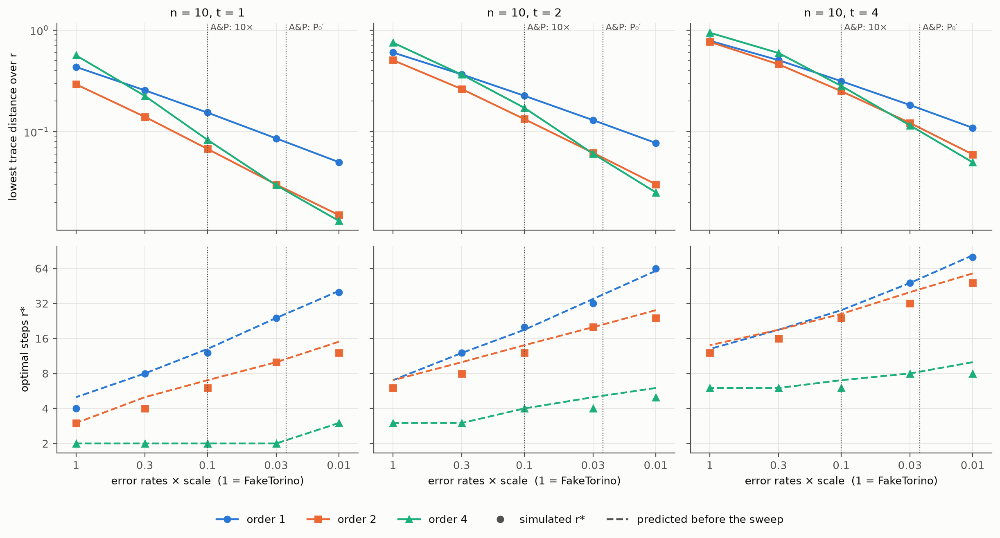
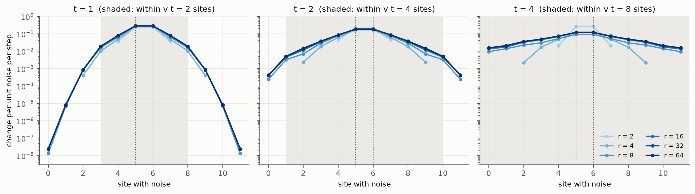
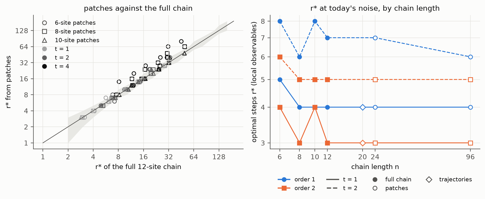
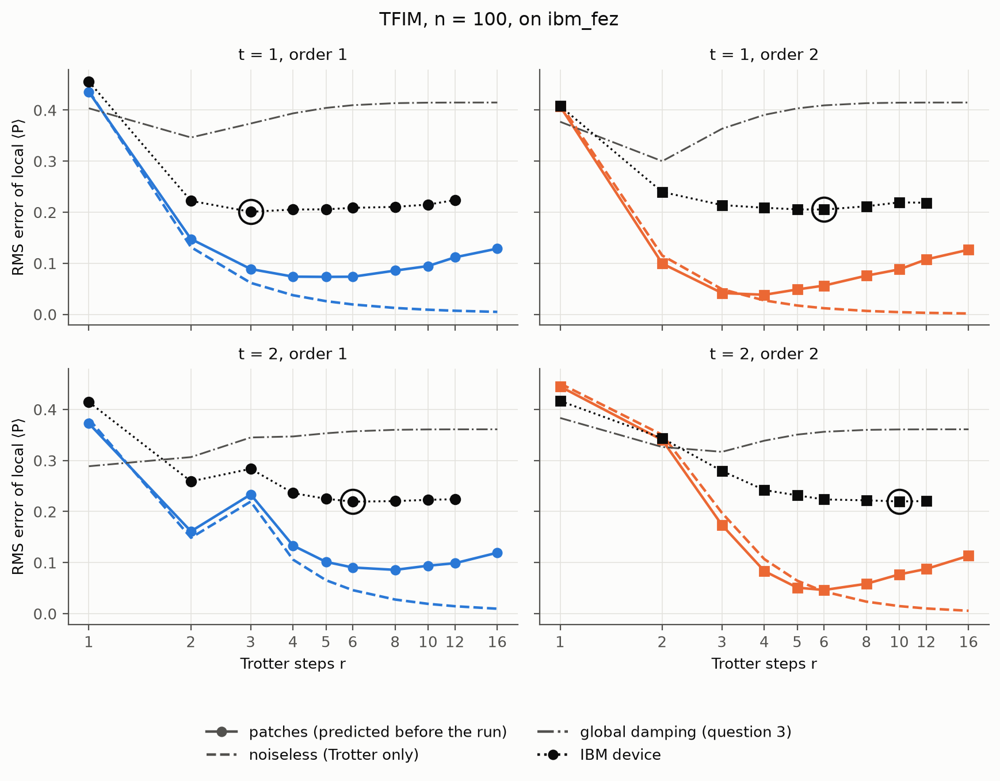
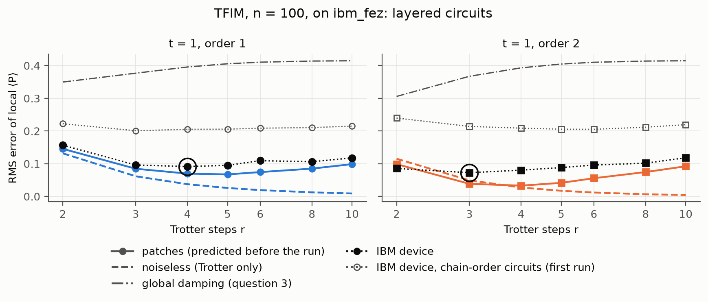

# Trotter error under hardware noise

On noisy hardware there is an optimal number of Trotter steps r\*: more steps shrink the Trotter
error but add gates, and gate noise grows with them. This project measures r\* for 1D spin
chains (4 to 12 qubits) under an IBM device noise model and compares it with two analytic
predictions, [Knee & Munro (2015)](https://arxiv.org/abs/1502.04536) and
[Avtandilyan & Pogosov (2024)](https://arxiv.org/abs/2405.01131), which assume one uniform
gate error rate. It also checks how loose standard Trotter error bounds are
([Childs et al., 2021](https://arxiv.org/abs/1912.08854)).

**Read the results:** the 4-page write-up ([PDF](writeup/writeup.pdf), [Markdown](writeup/writeup.md)) or the
full notebook, [`notebooks/trotter_under_noise.ipynb`](notebooks/trotter_under_noise.ipynb).
Questions 1 to 3 are complete, including one run on an IBM device, plus follow-ups in sections 5 and 6 of the notebook.

## Results so far

- **Bounds.** The commutator bound overestimates the worst-case Trotter error by about 6–7× at
  first order and 4× at second, at every chain length; the norm bound by 10²–10³× at orders 1–2
  and 10⁵–10⁸× at order 4, growing with n. Both reproduce Childs et al. on TFIM and XXZ chains.
- **Optimal step count.** Under the FakeTorino noise model, the measured r\* ranges from 1 to 16
  and grows with evolution time. Knee & Munro's prediction overshoots it by a median 2.4×,
  Avtandilyan & Pogosov's by 3.7× (orders 1 and 2; Knee & Munro's second order is our extension
  of their general form).
- **Why.** An ablation pins it on the Trotter term: the analytic constant exceeds the initial
  state's actual one by a median 15× (first order) and 9× (second), and swapping only that
  constant removes the overshoot, while changing only how the errors combine does not. Keeping
  the calibrated gate errors but using the state's noiseless Trotter error predicts r\* within one
  grid step in all 42 configurations with a clear minimum. A third formula,
  [Xu et al. (2025)](https://arxiv.org/abs/2504.10247), keeps the worst-case constant and lets late steps' errors
  decay as the state mixes; with calibrated noise it lands at Knee & Munro's r\* or a few percent above, so the decay
  does not remove the overshoot.
- **Order.** With two groups of terms, second order's outer half-steps merge (standard Strang
  splitting), so it costs the same two-qubit gates as first and wins everywhere. That overturns
  Avtandilyan & Pogosov's preference for first order, whose cost model charges second order double.
  Fourth order (5× the gates) loses everywhere at today's error rates.
- **Hardware.** On `ibm_kingston` (12-qubit chain, 18 circuits, 92 s of device time) the optimum
  falls where the device's own noise model puts it, r\* = 8 at first order and 6–8 at second, and
  the model tracks the device's error to within 0.01 at every r. The semi-empirical predictor,
  adapted to observables, lands one grid step low (6 and 4), because local observables decay
  several times more slowly than the global damping it assumes.
- **Better devices (follow-up).** With every Torino error rate scaled down by up to 100× (10-qubit
  TFIM), second order beats first at every level, and fourth order overtakes second only once errors
  are 23–31× lower, more than the order of magnitude Avtandilyan & Pogosov estimate. The
  semi-empirical predictor, run before these simulations (`results/noise_scaling_predicted.csv`),
  placed r\* within one grid step in all 45 configurations and picked the better order in 14 of 15.
  Both analytic formulas overshoot by the same factor at every noise level: their power law is right,
  their constant is not.
- **Second model (follow-up).** The XXZ chain under the same noise (4–10 qubits) repeats the
  pattern: Knee & Munro overshoot by 2.9× and 2.4× because their constant is 12× and 9× too large,
  and the semi-empirical predictor lands within one grid step in 30 of 31 configurations with a clear
  minimum.
- **Local observables (follow-up).** For the RMS error of every local Pauli (TFIM and XXZ, 6–12 qubits, five noise
  levels), r\* is close to the state's (within about 15%, except up to 1.6× at first order on the XXZ chain) and on the
  TFIM stops depending on the chain length once the chain is longer than the light cone. Noise on a single site
  reaches a central observable only from within about v t sites, at every r from 4 to 64, so the noise term grows
  linearly in r: r\* scales as γ^−1/(q+1) (γ^−1/3 at second order on both chains, γ^−0.47 at first order on the XXZ
  chain), not as the γ^−1/(q+2) of [Trivedi & Cirac (2025)](https://arxiv.org/abs/2509.17579)'s bound, which counts
  the whole circuit light cone. Whether fourth order pays off for local observables depends on the model: never on
  the TFIM even with every error rate 100× lower, from 10–30× lower on the XXZ chain.
- **Long chains (follow-up).** Light-cone patches, sub-chains of w sites simulated on the chain's own qubits, give r\*
  for local observables at the cost of a w-qubit simulation. 10-site patches match the full 12-site simulation for
  t ≤ 2 and noisy trajectories of a 20-qubit chain, and on a 96-qubit Torino chain they put r\* where it is at 12
  sites (4 and 3 steps at t = 1, first and second order).
- **100 qubits on a device (follow-up, pre-registered).** Patches under `ibm_fez`'s calibration predicted r\* for a
  100-qubit chain before the run (commit d6c2c04). The test failed: the device's r\* was within one grid step in 1 of
  4 cases, and its error was 3–5× the prediction (98 s of device time). The cause was our circuits: listed in chain
  order, the TFIM's ZZ bonds ran as one serial staircase, about 20 µs of idle per circuit whatever r, which 10-site
  patches do not have. The qubits that idled longest picked up phase errors (⟨X_i⟩ changed sign on 14 sites). With
  the bonds in two layers (same unitary, same gates), a second pre-registered run on the same qubits passed (commit
  dca91f3, 42 s): r\* within one grid step at both orders, error at the predicted r\* 0.08–0.10 against 0.21 before,
  still 1.4–2.4× the prediction.








## Layout

| Path | Contents |
| --- | --- |
| `qtrotter/` | Library: models, exact product formulas, bounds, circuits, noisy simulation, r\* fits and predictions, light-cone patches |
| `scripts/` | Sweeps that write `results/*.csv`, plus `gpu_check.py` |
| `config.yaml` | Every sweep setting; the notebook rebuilds all figures from the CSVs |
| `tests/` | Consistency checks (`python tests/test_core.py`) |
| `notebooks/` | The full analysis as a notebook |
| `writeup/` | 4-page write-up (Markdown source and PDF; `build.sh` rebuilds the PDF) |

## Reproduce

```bash
conda create -n qtrotter python=3.12 -y && conda activate qtrotter
pip install -r requirements.txt     # GPU: swap qiskit-aer for qiskit-aer-gpu
python tests/test_core.py
python scripts/run_noiseless.py     # question 1, ~20 min on a workstation CPU
python scripts/run_noisy.py         # question 2, ~40 min with a GPU
python scripts/run_hardware.py dry-run   # question 3 on a device's noise model (needs IBM credentials)
python scripts/run_hardware.py submit    # then `fetch`; uses about 1.5 min of device time
python scripts/run_noisy.py config.yaml noisy_xxz       # follow-up: XXZ under noise, ~26 min on 8 CPU cores
python scripts/predict_noise_scaling.py                 # follow-up: predictions, made without the sweep below
python scripts/run_noisy.py config.yaml noise_scaling   # follow-up: better devices, ~70 min on 8 CPU cores
python scripts/run_noisy.py config.yaml local           # follow-up: local observables, n = 6-12, ~2-3 h on a GPU
python scripts/run_noise_response.py                    # follow-up: single-site noise map, ~4 min on a GPU
python scripts/run_patches.py config.yaml patches       # follow-up: patches against the 12-site chain, ~45 min
python scripts/run_patches.py config.yaml patches_20    # patches on 20 sites, ~3 min
python scripts/run_trajectories.py                      # 20-qubit noisy trajectories, ~45 min on a GPU
python scripts/run_patches.py config.yaml patches_long  # patches on 24 sites, ~20 min
python scripts/run_patches.py config.yaml patches_96    # patches on 96 sites, ~15 min
python scripts/run_noisy.py config.yaml local_xxz       # the XXZ chain, ~2-3 h on a GPU
python scripts/run_noise_response.py config.yaml noise_response_xxz
python scripts/run_hardware_long.py dry-run             # 100-qubit layout and predictions (no QPU time)
python scripts/run_hardware_long.py submit              # then `fetch`; used 98 s of device time
python scripts/run_hardware_long.py dry-run hardware_long_layered   # the rerun with layered circuits; then
python scripts/run_hardware_long.py submit hardware_long_layered    # `fetch hardware_long_layered`; 42 s
```

## Design notes

- **Term grouping.** Each Hamiltonian is passed to `PauliEvolutionGate` as groups of commuting
  terms, `[X field, ZZ bonds]` for the TFIM. Passed as one operator, Qiskit's second-order
  formula costs 1.7 to 1.9 times the two-qubit gates of first order and about 5 times the depth.
- **Layer each group.** The terms of a group commute, so their order does not change the unitary, but it sets the
  schedule. Listed in chain order, the TFIM's ZZ bonds each share a qubit with the next and run one after another:
  about 0.2 µs per bond, 20 µs at 100 sites, with every site idling in a superposition for part of it.
  `trotter_circuit` therefore reorders each group into layers of disjoint support (`circuits.layered`: even bonds,
  then odd bonds). Results before the 100-qubit rerun were produced in chain order (2 µs of staircase at 12 sites,
  which the noise model includes); `trotter_circuit(..., layer=False)` rebuilds those circuits.
- **A hidden identity.** Second-order Trotter with the ZZ group outermost equals first-order
  Trotter conjugated by a half-step of ZZ. From |0...0>, Z-type observables then cannot tell the
  two orders apart (`tests/test_core.py` checks this). The X-outer grouping avoids it.
- **Synthesize before simulating.** `Statevector` on an unsynthesized `PauliEvolutionGate` uses
  the exact exponential, so it reports zero Trotter error.
- **Read out through the density matrix.** In Aer 0.18, `save_expectation_value` on a transpiled
  circuit whose chain is scattered over the device can return wrong values once Aer drops the idle
  qubits (0.000 or −0.078 where the exact value is 0.356). `save_density_matrix` on the chain
  qubits, used throughout, matches the exact state to 10⁻¹³.
- **Keep the noise model to the circuit's qubits.** Aer copies the whole noise model for every circuit with delays,
  about 2 s per run with Torino's 133 qubits, 25 times the simulation itself at 10 qubits.
  `qtrotter.noisy.density_matrix` passes a copy restricted to the circuit's own qubits, which gives the same state
  (checked to 10⁻¹² in the tests). For statevector trajectories, restrict after dropping the idle qubits: with the
  full noise model, Aer 0.18's statevector method crashed (segmentation fault) on these circuits.
- **Noise model.** FakeTorino calibration through Qiskit Aer, density-matrix method,
  optimization level 2, ALAP scheduling so idle qubits decohere, one fixed qubit layout per chain.

## License

MIT. See [LICENSE](LICENSE).
