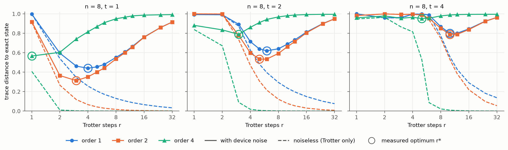
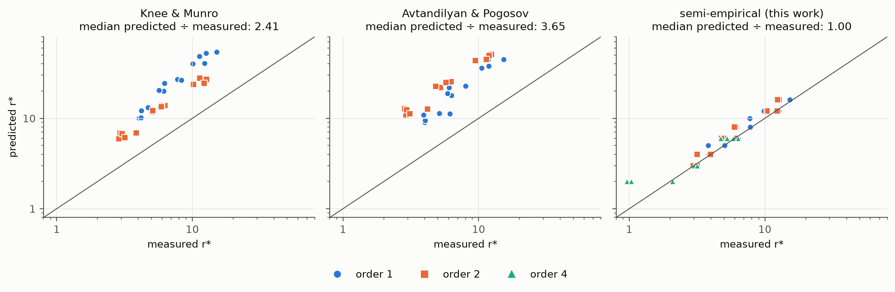

*Code, data and notebook: [github.com/jayhsu0627/qtrotter](https://github.com/jayhsu0627/qtrotter)*

## Abstract

On noisy hardware the number of Trotter steps $r$ has an optimum $r^*$, where shrinking Trotter error and growing gate
noise balance. Two analytic formulas predict $r^*$ from a single uniform gate error rate (Knee & Munro 2015;
Avtandilyan & Pogosov 2024). I test them on transverse-field Ising chains of 4 to 12 qubits simulated under the
calibrated noise model of IBM's Torino processor, and on a 12-qubit chain run on `ibm_kingston`. Both formulas get the
scaling right but overshoot $r^*$, by a median factor of 2.4 and 3.7. The overshoot comes from their worst-case Trotter
term: keeping the calibrated gate errors but using the initial state's actual Trotter error predicts $r^*$ within one
grid step in all 45 simulated configurations. On hardware, the measured optimum ($r^* = 8$ at first order, 6 to 8 at
second) matches the device's own noise model. Along the way I reproduce Childs et al.'s finding that commutator bounds
sit within a small constant factor of the true Trotter error while norm bounds are loose by orders of magnitude, and
show that grouping commuting terms makes second-order Trotter cost no more than first order, which makes it the best
choice at today's error rates.

## 1. Introduction

IBM's utility experiment (Kim et al. 2023) simulated a 2D Ising model on a 127-qubit processor with first-order Trotter
steps and error mitigation. Every such experiment must choose the step count $r$. More steps reduce the Trotter error
of a $p$-th order formula roughly as $r^{-p}$, but each step adds two-qubit gates, so accumulated gate noise grows with
$r$. The best $r$ is therefore a trade-off, not a precision setting.

Knee & Munro (2015) derived the optimal Trotter number for first-order formulas under faulty control, and Avtandilyan &
Pogosov (2024) extended the analysis to higher orders, concluding that higher-order formulas pay off only once gate
errors fall about tenfold. Both assume every gate fails independently at one shared rate. This study asks how close
their predicted $r^*$ is to the optimum measured under a realistic device noise model, with separate one- and
two-qubit error rates, idle decoherence and a real qubit layout, and on a real device.

## 2. Setup

**Models.** Open chains with $H_\mathrm{TFIM} = -J\sum_i Z_iZ_{i+1} - h\sum_i X_i$ ($J = h = 1$, initial state
$|0\cdots0\rangle$) and $H_\mathrm{XXZ} = \sum_i (X_iX_{i+1} + Y_iY_{i+1} + \Delta Z_iZ_{i+1})$ ($\Delta = 0.5$, Néel
initial state). Each Hamiltonian is split into two groups of commuting terms, $H = A + B$: the X field and the ZZ bonds
for the TFIM, even and odd bonds for XXZ.

**Formulas.** Lie–Trotter $S_1 = e^{-iB\delta}e^{-iA\delta}$, Strang
$S_2 = e^{-iA\delta/2}e^{-iB\delta}e^{-iA\delta/2}$, and Suzuki's fourth order (five $S_2$ stages), with
$\delta = t/r$. Circuits come from Qiskit's `PauliEvolutionGate` with the groups passed as a list. This matters: passed
as a single operator, Qiskit's second-order TFIM circuit puts the ZZ terms outermost and needs 1.7 times the two-qubit
gates and 5 times the depth of the grouped version (8 qubits, $r = 16$). Worse, since $S_2^r = a\,S_1^r\,a^{-1}$ with
$a$ a diagonal ZZ half-step, that ungrouped second-order circuit gives exactly the same Z-type observables as first
order from $|0\cdots0\rangle$. With the X field outermost, second order costs the same gates as first. An exact NumPy
implementation of the same formulas, checked against Qiskit's synthesized circuits, supplies noiseless errors.

**Bounds.** The commutator bounds of Childs et al. (2021), $\frac{t^2}{2r}\lVert[A,B]\rVert$ at first order and
$\frac{t^3}{r^2}\big(\frac{1}{12}\lVert[B,[B,A]]\rVert + \frac{1}{24}\lVert[A,[A,B]]\rVert\big)$ at second, and a norm
bound from the Taylor remainder, $r\cdot 2(\Gamma t/r)^{p+1}/(p+1)!\,e^{\Gamma t/r}$, with $\Gamma$ the sum of the
group norms weighted by the formula's coefficients.

**Noise.** Circuits are transpiled onto `FakeTorino` (optimization level 2, ALAP scheduling so idle qubits decohere,
one fixed layout per chain) and simulated as density matrices with Qiskit Aer under the backend's calibrated
depolarizing and thermal-relaxation errors (median CZ error $4.2\times10^{-3}$). Readout error is excluded. The
per-step error $p$ is the slope of the summed calibrated gate error of the transpiled circuit against $r$. The sweep
covers $n = 4$ to 12, $t \in \{1, 2, 4\}$, orders 1, 2 and 4, and $r$ from 1 to 32 (540 runs). The main metric is the
trace distance to the exact state $e^{-iHt}|\psi_0\rangle$.

**Hardware.** One Estimator job on `ibm_kingston` (Heron r2, Open plan): a 12-qubit TFIM chain at $t = 2$, orders 1
and 2 at nine values of $r$, 8192 shots per circuit, readout mitigation (TREX) only. The device returns expectation
values, so the metric is the RMS error over all 46 local Paulis ($Z_i$, $X_i$, $Z_iZ_{i+1}$, $X_iX_{i+1}$), with the
shot-noise bias subtracted and bootstrap error bars. The same circuits were simulated under the device's own
calibration at submission time. The job used 92 s of device time.

## 3. Results

**Bounds are loose in the way Childs et al. found.** At $t = 1$ the measured worst-case error falls as $r^{-1}$,
$r^{-2}$ and $r^{-4}$. Over $r \ge 16$, the commutator bound overestimates it by a median 6.5 (TFIM) and 7.2 (XXZ) at
first order and 4.0 and 3.8 at second, independent of chain length, since both grow linearly in $n$. The norm bound
overestimates by $10^2$ to $10^3$ at orders 1 and 2 and $10^5$ to $10^8$ at order 4, growing with $n$ because it scales
as $n^{p+1}$.

**The optimum under device noise.** Figure 1 shows the trade-off for an 8-qubit chain. The noisy error first falls
with the Trotter error, then rises as gates accumulate. The optimum grows with evolution time: at second order,
$r^* = 3$–4 at $t = 1$, 5–6 at $t = 2$ and 10–12 at $t = 4$, across all chain lengths. At the optimum the error is
already large, and at 10 to 12 qubits and $t = 4$ the state is close to maximally mixed for every $r$.

{width=100%}

**Analytic predictions overshoot.** Both papers minimize $a/r^q + b\,r$, giving $r^* = (qa/b)^{1/(q+1)}$. Fed each
paper's own Trotter constant $a$ and the calibrated per-step error $b$, Knee & Munro's formula overshoots the measured
$r^*$ by a median 3.4 at first order and 2.3 at second; Avtandilyan & Pogosov's by 2.8 and 4.2 (Figure 2). To make
Knee & Munro's prediction exact, the per-step error would have to be about 11 to 12 times the calibrated value at both
orders.

{width=100%}

The cause is the Trotter side, not the noise side. Both formulas use a worst-case quantity (an operator or diamond norm
over all inputs), which the bound results already show overestimates by 4 to 7 times, and the error of one specific
initial state is smaller still. Since $r^* \propto a^{1/(q+1)}$, an inflated $a$ inflates $r^*$. A semi-empirical
predictor that keeps the calibrated $p$ but replaces the analytic term with the state's actual noiseless Trotter error
$E_T(r)$, minimizing $1 - (1 - E_T(r))\,e^{-pr}$, lands within one grid step of the measured $r^*$ in all 45
configurations, including fourth order. It needs no noisy simulation, but it does need $E_T(r)$, which is cheap here
only because the chains are small.

**Second order is the right choice at these error rates.** With grouped terms, orders 1 and 2 cost the same
$2(n-1)$ two-qubit gates per step, and second order reaches a lower error at its optimum in all 15 combinations of $n$
and $t$. Fourth order costs five times as much and is worst everywhere. Avtandilyan & Pogosov find first order optimal
at error rates like these because their cost model charges second order twice the gates; grouping removes that cost.

**Hardware agrees with its noise model.** On `ibm_kingston` the RMS observable error falls with $r$, reaches a minimum
and rises again, exactly as simulated (Figure 3). The device's optimum is $r^* = 8$ at first order (error 0.062 against
0.060 predicted) and a tie between 6 and 8 at second order (0.041 against 0.033). Across all 18 circuits the device
stays within 0.01 of its noise model, and is measurably worse only near the second-order optimum (about four standard
errors). The analytic formulas again overshoot, predicting $r^* = 34$ and 17 (Knee & Munro) and 30 and 31
(Avtandilyan & Pogosov). Second order beats first on the device too, at two thirds of the error for the same gates.

{width=88%}

## 4. Related work

Beyond the two formulas tested here, Heyl, Hauke & Zoller (2019) showed that Trotter errors in local observables stay
bounded below a threshold step size. Pastori et al. (2022) proposed learning the effective Floquet Hamiltonian of a
Trotterized device to characterize its errors and find its optimal operating regime, demonstrated numerically. Xu et al.
(2025) derived an improved error analysis with an optimal number of Trotter steps for noisy devices, supported by
numerical simulations. Trivedi & Cirac (2025) proved that local observables in lattice models can be obtained to
system-size-independent precision under noise. Murota, Todo & Endo (2026) analysed the optimal depth with probabilistic
error cancellation. This study is empirical: it tests two published formulas against calibrated noise models and a real
device, and identifies which side of their trade-off is off.

## 5. Limitations and next steps

The sweeps use one noise snapshot and Aer's noise model (no crosstalk, leakage or drift); the hardware check is one
chain, one evolution time and one day's calibration; $r$ is sampled on a grid. The semi-empirical predictor needs the
noiseless Trotter error, which is classically cheap only for small systems. The natural next step is to compute that
error for local observables on a light-cone-sized patch of the chain, which stays cheap at any system size, and to
validate the resulting predictor on large heavy-hex circuits across several devices and with error mitigation.

## References

1. G. C. Knee, W. J. Munro, Optimal Trotterization in universal quantum simulators under faulty control, Phys. Rev. A 91, 052327 (2015).
2. A. A. Avtandilyan, W. V. Pogosov, Optimal-order Trotter–Suzuki decomposition for quantum simulation on noisy quantum computers, arXiv:2405.01131 (2024).
3. A. M. Childs, Y. Su, M. C. Tran, N. Wiebe, S. Zhu, Theory of Trotter error with commutator scaling, Phys. Rev. X 11, 011020 (2021).
4. Y. Kim et al., Evidence for the utility of quantum computing before fault tolerance, Nature 618, 500 (2023).
5. M. Heyl, P. Hauke, P. Zoller, Quantum localization bounds Trotter errors in digital quantum simulation, Sci. Adv. 5, eaau8342 (2019).
6. L. Pastori, T. Olsacher, C. Kokail, P. Zoller, Characterization and verification of Trotterized digital quantum simulation via Hamiltonian and Liouvillian learning, PRX Quantum 3, 030324 (2022).
7. J. Xu, C. Zhao, J. Fan, Q. Zhao, Exponentially decaying quantum simulation error with noisy devices, arXiv:2504.10247 (2025).
8. R. Trivedi, J. I. Cirac, Noise robustness of problem-to-simulator mappings for quantum many-body physics, arXiv:2509.17579 (2025).
9. K. Murota, S. Todo, S. Endo, Error-mitigated Hamiltonian simulation: complexity analysis and optimization for near-term and early-fault-tolerant quantum computers, arXiv:2603.11527 (2026).
